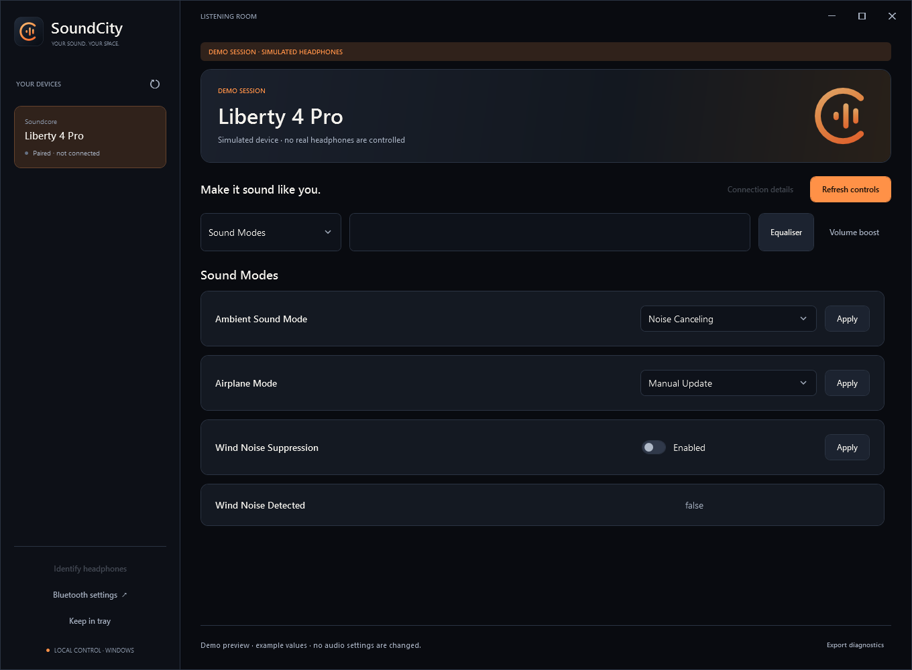
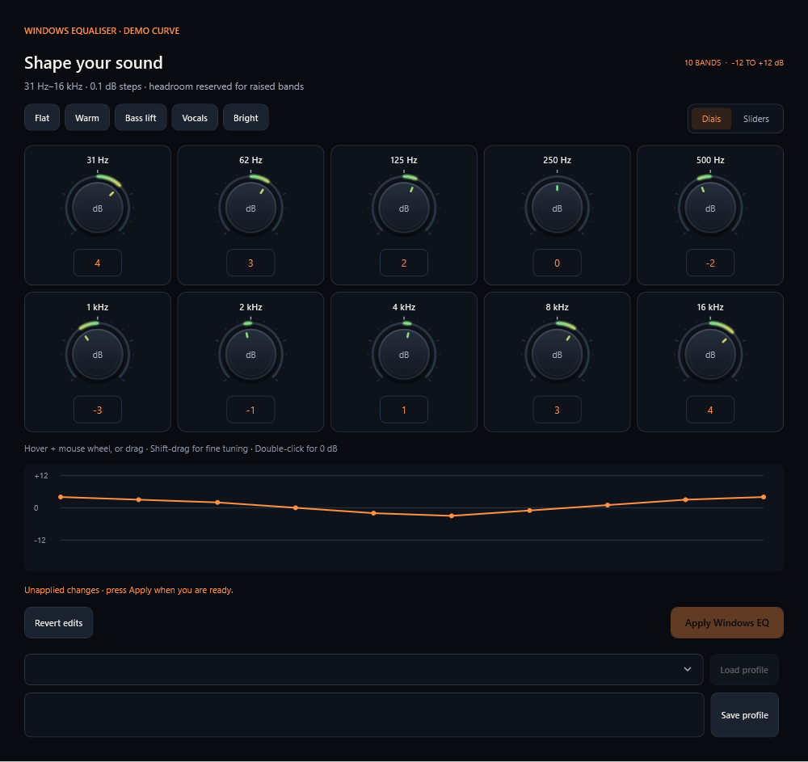
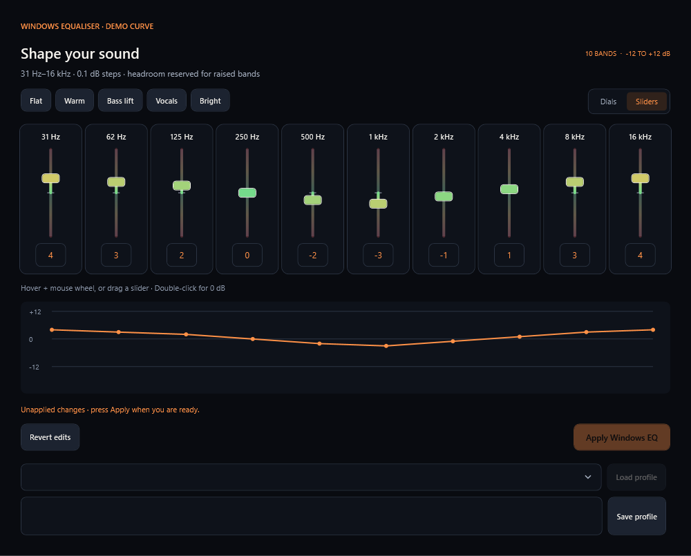

<p align="center">
  
</p>

<p align="center"><strong>Headphone controls, equaliser and optional volume boost for Windows.</strong><br>
A native desktop app in graphite, midnight and orange.</p>

<p align="center">
  <a href="https://github.com/GoblinRules/SoundCity/releases/latest"></a>
  
  
  <a href="LICENSE.txt"></a>
</p>

<p align="center">
  <a href="#get-soundcity">Download</a> ·
  <a href="#a-look-inside">Screenshots</a> ·
  <a href="#device-support">Device support</a> ·
  <a href="docs/USAGE.md">User guide</a> ·
  <a href="https://github.com/GoblinRules/SoundCity/issues">Report an issue</a>
</p>

## Get SoundCity

| Download | Choose this for |
| --- | --- |
| **[Windows installer · v0.1.0](https://github.com/GoblinRules/SoundCity/releases/download/v0.1.0/SoundCity-0.1.0-Setup-x64.exe)** | The easiest setup: a Start menu shortcut, optional desktop shortcut and Windows uninstall entry. |
| [Portable ZIP · v0.1.0](https://github.com/GoblinRules/SoundCity/releases/download/v0.1.0/SoundCity-0.1.0-Portable-x64.zip) | Extract into a folder and open `SoundCity.exe`. |
| [SHA-256 checksums](https://github.com/GoblinRules/SoundCity/releases/download/v0.1.0/SHA256SUMS.txt) | Verify the downloaded installer or ZIP. |

**Requirements:** Windows 10 version 2004 or newer, or Windows 11, with x64 support. The .NET 10 runtime is included. SoundCity installs for your Windows account without administrator access.

This first release is **unsigned**, so Windows may display an unknown-publisher or SmartScreen warning. Read the [release notes](https://github.com/GoblinRules/SoundCity/releases/latest) for validation and known limitations. Equalizer APO is a separate, optional installation.

## A look inside



*Rendered from the application's actual WPF interface with labelled demo data. No live device names, addresses or personal profiles appear in these images.*

### Dials or sliders. The same curve.

<table>
  <tr>
    <td align="center"><strong>Rotary dials</strong></td>
    <td align="center"><strong>Precision sliders</strong></td>
  </tr>
  <tr>
    <td><a href="docs/images/equaliser-dials.png"></a></td>
    <td><a href="docs/images/equaliser-sliders.png"></a></td>
  </tr>
</table>

Switch views without losing your draft. Hover and use the mouse wheel, drag a control, or enter an exact dB value. Green → amber → red indicates gain moving away from zero in either direction, for both cuts and boosts. Click an image for the full-size view.

*The pictured curve is illustrative, not a measured headphone correction or a recommended listening preset.*

## What you can do

- **Control supported headphones.** Read available listening modes, onboard EQ and device preferences. Controls depend on the exact model and firmware.
- **Tune Windows audio.** Ten EQ bands from 31 Hz to 16 kHz, ±12 dB adjustment, numeric entry and a live gain curve.
- **Save your own sound.** Flat, Warm, Bass lift, Vocals and Bright starting curves, plus local profiles scoped to each model.
- **Choose your controls.** Dials and sliders share values; EQ and boost remember their view choices separately.
- **Add gain to quiet recordings.** Optional 0 to +12 dB boost in 0.5 dB steps through Equalizer APO.
- **Keep it local.** Normal headphone control needs no SoundCity account or cloud service. Minimise to the tray when you are done adjusting.

Edits take effect when you press **Apply**. Changing views or loading a profile does not apply audio changes.

## Get started

1. Install SoundCity, or extract the portable ZIP.
2. Pair your headphones in **Windows Bluetooth settings** and turn them on.
3. Open SoundCity and select your headphones. Supported connected models load their available controls; use **Refresh controls** to read again.
4. Adjust a setting and press **Apply**. Use **Equaliser** for tuning or **Volume boost** for optional Windows processing.

For a renamed device, choose **Identify headphones** and confirm its exact model. Life P3 requires confirmation of model **A3939**. Generic names such as “AirPods Pro” are not silently assigned to a generation.

[Full user guide →](docs/USAGE.md)

## Device support

“Windows audio” means volume/mute for a matching connected output, plus optional Windows EQ and boost after Equalizer APO setup. It does **not** imply support for the manufacturer's advanced controls.

| Headphones | Controls in SoundCity | Validation and limits |
| --- | --- | --- |
| **Soundcore Liberty 4 Pro · A3954** | Model-reported controls through OpenSCQ30, including EQ and listening modes. | Simulated reads/writes tested; physical validation pending. |
| **Soundcore Life P3 · A3939** | Model-reported controls through OpenSCQ30. | Confirm the model first. Simulated reads/writes tested; physical validation pending. |
| **UGREEN Studio Max5s · HP208** | ANC, EQ presets/custom bands, spatial/game modes, multipoint and other reported settings. | Live status reads verified on firmware 0.1.5. Writes implemented with acknowledgement/readback; physical write validation pending. |
| **UGREEN FitBuds · WS213** | Windows audio. | Vendor controls await exact-model protocol verification. |
| **Parrot Zik 3** | Experimental noise modes, Concert Hall, saved onboard EQ on/off, head detection and auto-connect. | Simulated protocol tests pass. Physical validation pending; custom onboard EQ bands are not exposed. |
| **Beats Solo Buds** | Windows audio. | Vendor battery/button controls are not integrated. Solo Buds have no ANC or transparency. |
| **Apple AirPods Pro 3** | Windows audio. | Apple battery, ANC, Adaptive Audio and ear detection are not integrated; no Apple driver is installed. |

Availability can change with firmware and device state. SoundCity exposes reported capabilities rather than inventing controls or battery values. See [device implementation notes](docs/DEVICE-SUPPORT.md) for protocols, model codes and outstanding validation.

## Windows EQ and volume boost

Windows processing uses **[Equalizer APO](https://sourceforge.net/projects/equalizerapo/)**. Install it separately, enable it for the intended headphone playback output, and restart Windows if requested. SoundCity checks the selected output before allowing Apply. Headphone onboard EQ works separately.

EQ and boost start off. Positive EQ bands reserve preamp headroom; explicit boost can use that headroom and may cause clipping. Start low and reduce gain if you hear distortion. “Configured” means the settings were saved, not proof that APO is processing the current playback path; exclusive-mode playback can bypass it.

[Setup and troubleshooting →](docs/USAGE.md#windows-eq-and-boost-setup)

## Build and contribute

Install the **.NET 10 SDK**, clone this repository, and run from PowerShell:

```powershell
powershell -NoProfile -ExecutionPolicy Bypass -File scripts/Build.ps1 -Publish
powershell -NoProfile -ExecutionPolicy Bypass -File scripts/Start-SoundCity.ps1
```

The published app is written to `artifacts/SoundCity/`. Setup downloads OpenSCQ30 **v2.13.0** and verifies pinned SHA-256 hashes for the engine and its source archive. The runtime and third-party license notices are bundled with published builds.

```powershell
# 142 core/backend checks, using simulated devices
dotnet run --project tests/SoundCity.Tests -c Release -- --engine
# 29 in-memory UI checks; no live audio or headphone writes
dotnet run --project tests/SoundCity.UiTests -c Release
```

For a first look without headphones, run `SoundCity.exe --demo`. Demo values are explicitly marked and are not evidence of hardware compatibility.

Useful guides:

- [Using SoundCity, shortcuts and troubleshooting](docs/USAGE.md)
- [Device protocols and validation](docs/DEVICE-SUPPORT.md)
- [Building the installer and publishing releases](docs/RELEASING.md)
- [Regenerating the README images](docs/images/README.md)

Bug reports are most useful with the exact model code, firmware, Windows version and steps to reproduce. Review diagnostics before sharing them and remove personal device names, addresses and serial numbers. New-device work needs evidence for the exact model, not a similar product name.

## Privacy and license

Profiles, model selections and display preferences are stored locally in `%LOCALAPPDATA%\SoundCity`. Diagnostics are saved locally only when requested and are not automatically uploaded. Uninstalling preserves profiles and existing Equalizer APO configuration.

SoundCity is licensed under **[GPL-3.0-only](LICENSE.txt)**. It uses [OpenSCQ30](https://github.com/Oppzippy/OpenSCQ30) as a separate engine and draws on public interoperability research. Thanks to the authors of [SoundcoreDesktop](https://github.com/DamienStaebler/SoundcoreDesktop), [SoundcoreManager](https://github.com/gmallios/SoundcoreManager) and the projects listed in [third-party notices](THIRD-PARTY-NOTICES.txt).

SoundCity is independent of Anker, Soundcore, UGREEN, Parrot, Beats and Apple. Product names belong to their respective owners; no vendor artwork is bundled.
